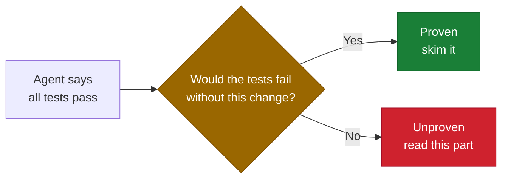
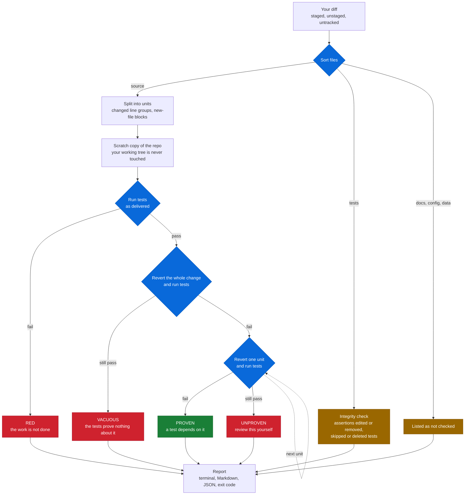
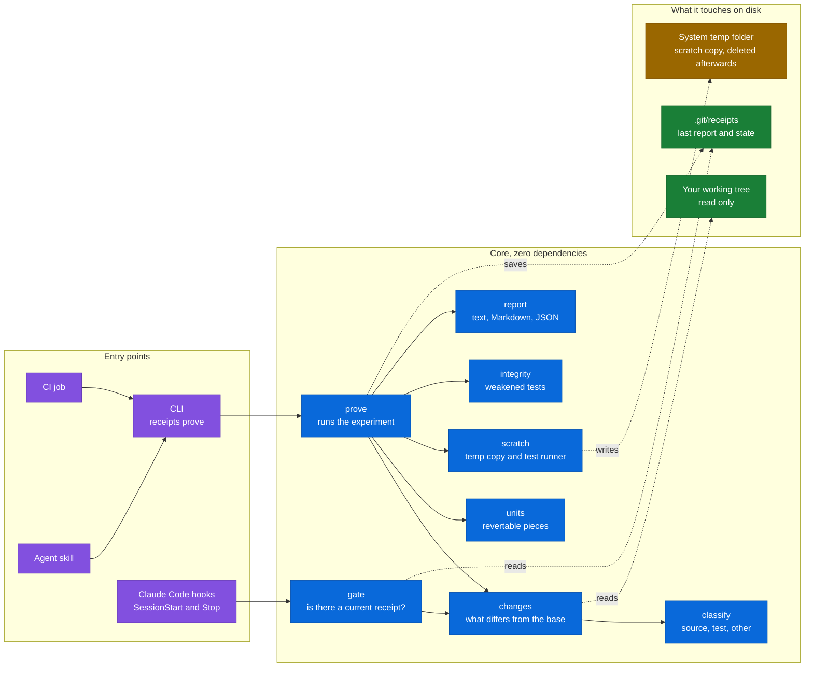

# receipts

**Which of these code changes would a test actually notice?**

An AI agent (or a person) hands you a diff and says "tests pass". Receipts answers
the question that sentence skips: would the tests have failed if the change were
missing? For each piece of source code that changed, it puts the old code back
in a scratch copy of your repo and runs your tests.

- Tests fail with the old code: the change is **proven**. Something depends on it.
- Tests still pass: the change is **unproven**. Nothing checks it. Review it yourself.

No model calls, no network, no dependencies. It needs git, Node 20+, and a test command.

```
$ receipts prove

receipts  base HEAD (7c1a9cc)  ·  test: npm test

  as delivered        tests pass 0.2s
  change reverted     tests fail (good: they notice the change) 0.2s

  src/cart.mjs
    ✓ L3           proven    tests fail with the old code   | for (const item of items) sum += item.price * Math.max(0, ite...
    ✗ L9           UNPROVEN  tests still pass with the old code   | if (code === 'SAVE20') return amount * 0.8;
  src/shipping.mjs (new file)
    ✓ L1-3         proven    tests fail with the old code   | export function cost(kg) {
    ✗ L5-7         UNPROVEN  tests still pass with the old code   | export function eta(days) {

  test integrity
    ! test/cart.test.mjs: existing assertions changed or removed (1, e.g. `assert.equal(discount(100, 'NOPE'), 100);`)

  2/4 changes proven (50%)  ·  2 need review  ·  1 test integrity warning
  Some changes have no test that would notice if they were undone.
```

That is real output. Reproduce it with `./examples/demo.sh`.

The point is review time. Instead of re-reading a whole diff, you read the two
lines no test is holding up, and the one assertion that quietly disappeared.

## Why this exists

AI agents now write code faster than anyone can review it. The evidence they
offer is almost always the same sentence: "all tests pass". That sentence has a
hole in it, because the agent usually wrote the code *and* the tests. A suite
can be green while checking nothing about the change in front of you.

The checks people already lean on each answer a different, easier question:

| Signal | What it tells you | What it cannot tell you |
|---|---|---|
| Tests pass | Nothing that is tested is broken | Whether this change is tested at all |
| Line coverage | The changed lines were executed | Whether anything asserted on the result |
| "Did the agent really run the tests?" checkers | The claim matches what ran | Whether passing means anything |
| Human review | Everything, in principle | Scales with diff size, not with risk |
| **Receipts** | **Which changes a test would notice if they vanished** | Whether the change is correct (see limits) |

So the reviewer is stuck: trust the green tick, or re-read every line. Receipts
gives a third option. It runs the one experiment that separates real evidence
from decoration, *undo the change and see whether anything complains*, and
hands back a short list of the changes nothing complained about.



## Use it

```bash
git clone https://github.com/CHAI-THUB/receipts && cd receipts
npm link                      # puts `receipts` on your PATH (or run node bin/receipts.mjs)

cd ~/your-project
receipts prove                # uncommitted work vs HEAD
receipts prove --base main    # everything on this branch, committed or not
receipts prove --test "pytest -q -x" --md receipts.md
```

The test command is taken from `--test`, then `.receipts.json`, then detected
(npm/pnpm/yarn/bun `test` script, `go test ./...`, `cargo test`, pytest, `make test`).

`.receipts.json` (optional, commit it):

```json
{ "test": "npm test", "base": "main", "budget": 600 }
```

| Exit code | Meaning |
|---|---|
| 0 | every checkable change is proven |
| 1 | something is unproven (or below `--min`, or `--strict` with integrity warnings) |
| 2 | tests fail on the change as delivered |
| 3 | usage or setup problem |

Run `receipts help` for all options.

### In CI

```yaml
- uses: actions/checkout@v4
  with: { fetch-depth: 0 }
- run: npx -y github:CHAI-THUB/receipts prove --base origin/${{ github.base_ref }} --md receipts.md --min 80
- run: cat receipts.md >> "$GITHUB_STEP_SUMMARY"
  if: always()
```

### With Claude Code

The repo is also a plugin: a skill that teaches the agent to run receipts and
report the result honestly, and two hooks.

```
/plugin marketplace add CHAI-THUB/receipts
/plugin install receipts@receipts
```

The Stop hook checks one fact: source code changed and there is no receipt for
its current state. If so, it sends the agent back once to run `receipts prove`
and include the result. It never parses what the agent said, never nags twice
for the same code, and stays silent for docs-only changes. Committing the work
does not hide it: the SessionStart hook records where the session began.

## How it works



1. Collect what changed against the base: staged, unstaged and untracked files.
2. Sort files into source, tests, and everything else (docs, config, data).
3. Copy the working tree to a temp directory. Git-ignored entries such as
   `node_modules` are symlinked so tests can run. **Your working tree is never modified.**
4. Run the tests as delivered. If they fail, stop: verdict `red`.
5. Revert all source changes at once, keep the new tests, run again. If the
   tests still pass, they say nothing about this change: verdict `vacuous`.
6. For each changed unit, revert only that unit and run the tests.
   - In a modified file, a unit is a group of changed lines (edits within two lines of each other are one unit).
   - In a new file, a unit is a top-level block, so one untested function in a new file stands out.
   - Comment-only and whitespace-only edits are marked `trivial` and not run.
7. Separately, compare test files before and after: assertions that vanished or
   were edited, tests skipped or focused, test cases or files removed.

Cost: about (number of units + 2) test runs. Use a fast, fail-fast test command.
`--budget` and `--max-units` cap the work; anything skipped is reported as `not run`, never as proven.

## Architecture

Four ways in, one small core, and a strict rule about what gets touched: the
working tree is only ever read, all experiments happen in a copy in the system
temp folder, and the only thing written to your repo is a report inside `.git/`,
where it cannot show up in `git status`.



| Path | Role |
|---|---|
| `bin/receipts.mjs` | Command line: `prove`, `report`, and the two hook entry points |
| `src/changes.mjs`, `src/classify.mjs` | Find what changed and sort it into source, test, other |
| `src/hunks.mjs` | Split each changed file into units that can be reverted on their own |
| `src/scratch.mjs` | Build the temporary copy, run the test command, refuse writes outside the copy |
| `src/prove.mjs` | The experiment: as delivered, whole change reverted, then one unit at a time |
| `src/integrity.mjs` | Spot weakened tests |
| `src/report.mjs` | Terminal, Markdown and JSON output |
| `src/gate.mjs`, `hooks/hooks.json` | Ask an agent for a receipt once per code state |
| `skills/receipts/SKILL.md` | Teaches an agent to run receipts and report the result as-is |

## What "proven" does and does not mean

Read this before trusting the number.

- **Proven means the tests notice the change is missing. It does not mean the change is correct.**
- Proof can be merely structural. If reverting a unit breaks an import or leaves
  a name undefined, every test fails and the unit counts as proven even if no
  test exercises its behaviour.
- Unproven is not a bug report. Logging, wiring and UI glue are often
  legitimately untested. The claim is only: no test stands behind this.
- The integrity check is a heuristic over text. It flags an assertion you
  strengthened the same way as one you weakened, because both changed. It is a
  pointer for a human, not a verdict.
- A flaky suite produces false "proven" results. A suite that caches results
  by something other than file content can produce false "unproven" ones.
- Tests run in a copy with no `.git` directory, and symlinked ignored
  directories are shared with your real checkout. Tests that need git metadata,
  or that write into ignored build folders, may behave differently.
- Config, docs and data files are listed as "not checked".

## Status

v0.1, built in one sitting. Tested: 22 automated tests (JavaScript and Python
fixtures), the demo above, and a run against its own codebase. Not yet tested:
Windows, monorepos with per-package test commands, large repositories, and the
hooks inside a live Claude Code session (the plugin manifest passes
`claude plugin validate`; hook behaviour is covered by tests that feed it
hook input directly).

## Related work

This is a small, language-agnostic cousin of mutation testing, where the only
mutant is "the code before the change". Real mutation tools (Stryker, PIT,
cargo-mutants, mutmut) understand their language and find far more; use them if
your stack has one. Tools such as groundtruth, no-vibes and Verify check a
different thing: whether an agent's "tests pass" claim matches what ran.
Receipts starts where they stop: the tests ran and passed, so what did that prove?

## Next

- Tell behavioural proof from structural proof (did an assertion fail, or did the file fail to load?)
- Parallel scratch copies
- Per-package test commands for monorepos
- A pull-request comment mode

MIT licensed.
